# FilMachine – macchina completa (rilascio 6)

Progetto meccanico di tutta la macchina: tank a tenuta di luce con caricatore integrato per **135 e 120**, bagno
termostatico con tre vaschette che pescano **dal basso**, idraulica con ingresso dell'acqua di rete e sensori di livello,
cavalletto con pompa, vano elettronica con display sul cruscotto inclinato, scocca a parallelepipedo in pannelli di
Dibond con coperchio trasparente.
Usa i componenti già acquistati e i collegamenti già previsti dal firmware `FilMachine_Reworked`.

**È un progetto, non una macchina provata.** Tutto quello che segue è verificato sul modello 3D (interferenze, movimenti,
volumi, viti); niente è stato stampato né misurato. I punti da provare a banco sono elencati in fondo.

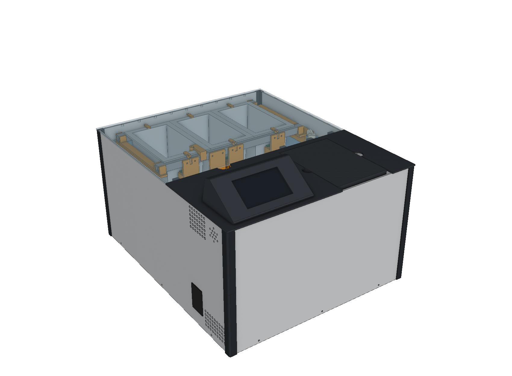

## Aggiornamenti 6.2 e 6.3: spirali e scivolo come la Lab-Box

- **Una coppia di flange per formato**, come nella Lab-Box. Le flange **135** (A01, A02) sono quelle di prima: 8 giri a
  passo 2,2 mm, 180 cm di pellicola. Le nuove flange **120** (A10, A11) hanno 5,5 giri a passo **3,1 mm**: il 120 è
  lungo la metà ma largo quasi il doppio, e con i giri più distanziati non tocca il giro accanto. Il rapporto tra i due
  passi, 1,38, è quello misurato sulla Lab-Box (3,08 e 2,23 mm). Tubo, anelli alette e trascinamento restano in
  comune. I file delle flange 135 ora si chiamano `A01_flangia_135_A` e `A02_flangia_135_B`.
- **Niente tamburo**, come nella Lab-Box: tra due **collarini**, che tengono centrata la fascetta, il tubo A03 ha un
  **passaggio da parte a parte**. Da un lato una **finestra larga**, da cui la fascetta si infila; dal lato opposto una
  **finestra stretta**, da cui passa solo la fascetta: il perno sul suo capo resta dentro e non la lascia uscire. La
  fascetta è quella della Lab-Box, comprata già fatta (larga 14,5 mm, spessa 0,15, con un piolino di 3,25 × 15,8 mm sul
  capo), e si avvolge direttamente sul tubo. Finestre dalle misure della Lab-Box: **stretta 2,5 mm** come l'originale,
  **larga 3,6 mm** (nella Lab-Box 3,43: un po' di più perché le fessure stampate vengono strette), **alte 18 mm** (nella
  Lab-Box 19: qui 18 per lasciare gioco ai manicotti delle flange 135). Il pezzo A04 non c'è più, e nemmeno la clip
  stampata (A07, A08): la fascetta Lab-Box ha già la sua.
  Senza tamburo la costola d'attacco della spirale arriva fino al mozzo della flangia, cioè al centro; a spirale vuota
  lo scivolo appoggia sui manicotti delle flange.

  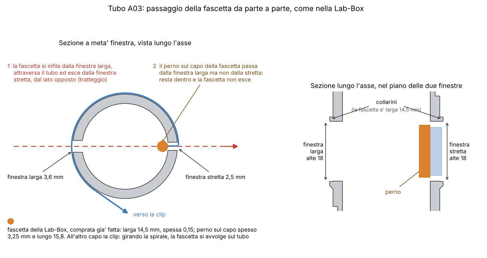
- **Click della baionetta**: il dentino della linguetta è più alto (0,55 mm, era 0,4) e dal lato dello sblocco dentino e
  gola hanno un **fianco ripido a 70°** (prima 45°). Bloccando si sente lo scatto; per svitare il dentino deve risalire
  lo scalino, quindi il reel non si svita da solo e va girato con decisione. Vale per le flange e per gli anelli alette.
  La gola del click c'è **solo nelle tre stazioni** di ogni lato, dove arriva il dentino: tra i collarini il tubo è liscio.
- **Scivolo rifatto sullo stile della Lab-Box (6.3)**. Ogni slitta è una lamina sottile (suola 1,4 mm, parete 1,2) con
  il **labbro a C** che sporge sopra il bordo della pellicola, come nel pezzo originale: all'imbocco, dal lato della barra,
  il **cappuccio** con il bordo arrotondato e la bocca aperta (il labbro e il fondo della gola fanno una V di 4 mm in
  cui il bordo della pellicola entra anche se non è perfettamente allineato); lungo la **spalla** la gola si stringe fino
  al canale che entra tra le flange, dove la gola stretta tiene i bordi della pellicola incurvata; sotto la gola la suola
  si alza in una rotaia. Il bordo interno della suola rientra con uno smusso dritto: le due slitte insieme fanno la
  **coda di pesce** della Lab-Box, con le punte smussate a V. Il **mozzo è un blocco sotto la suola**, dalla giunzione
  con l'altra slitta (a 135 i due mozzi si toccano quasi, come nella Lab-Box) fino all'**orecchia esterna** con la vite
  zigrinata, che ora sta fuori dal cappuccio e non lo intacca più (**M3 × 10**, era M3 × 6). Le superfici sono rigate
  pulite, non più sfaccettate. Quote funzionali invariate: vertice della gola a 14,5 mm tra le flange, canale 0,2 mm
  dentro le punte delle costole, altezze sotto il coperchio.

## Cosa c'è nel pacchetto

| Cartella / file | Contenuto |
|---|---|
| `docs/FilMachine_3D.pdf` | **Assieme 3D navigabile** (Adobe Acrobat Reader): ogni corpo con il suo nome, da accendere e spegnere uno a uno o a gruppi, 10 viste pronte. `docs/FilMachine.u3d` è lo stesso modello da solo |
| `step/ASSIEME_FilMachine.step` | Lo stesso assieme per il CAD |
| `step/`, `stl/` | 71 pezzi diversi, **già nell'orientamento di stampa** (123 da stampare contando le quantità, comprese le due coppie di flange 135 e 120; A06 è una variante facoltativa) |
| `docs/pannelli/` | **Pannelli da tagliare**: un DXF per pannello (Dibond 3 mm e plexiglass 3 mm, vista dall'esterno) e `pannelli.pdf` con quote e fori |
| `docs/NuovaDistinta.xlsx` | Distinta: da acquistare, già acquistati e loro uso, pezzi stampati, viteria, pannelli |
| `docs/schema_idraulico.pdf`, `docs/schema_elettrico.pdf` | Schemi |
| `docs/dima_base.pdf` (+ `_fori.csv`) | Dima 1:1 della base con i 29 fori |
| `docs/note_firmware.md` | Cosa funziona col firmware di oggi, cosa va cambiato (ingresso dell'acqua), cosa significano i sensori |
| `verifiche.txt` | Tutti i controlli eseguiti sul modello: stampabilità, movimenti, volumi, viti, tagli dei tubi |
| `png/` | Viste e sezioni |
| `src/` | Sorgenti parametrici (CadQuery): le misure stanno in `common.py` e `machine.py`, la scocca in `shell.py` |

## La macchina in breve

Un parallelepipedo di circa **43 × 52 × 26 cm** (431 × 516 mm in pianta; il piano e il coperchio sono a 264 mm dal
fondo della base), più il cruscotto del display che sporge sopra il piano, davanti a sinistra, fino a circa 32 cm.
Tutto è **a filo**: piano anteriore, bocca della tank, vaschette e coperchio trasparente stanno alla stessa quota.

- **Davanti a sinistra**: vano elettronica; sopra, sul piano, il **cruscotto inclinato a 34°** con il display da 4,3".
- **Davanti a destra**: la tank, incassata nel piano su un cavalletto; sotto, la pompa e l'ingresso dell'acqua di rete.
- **In mezzo, dietro la paratia**: le cinque elettrovalvole sul collettore (da sinistra C1, WB, C2, C3, scarico), con
  sopra le tre camere di livello trasparenti.
- **Dietro**: il bagno (contenitore Euro 400 × 300 × 220) con le tre vaschette GN 1/9 appese ai longheroni, sotto un
  **coperchio di plexiglass**: si vede la chimica entrare e uscire.
- **Fianco destro**: gli attacchi INGRESSO (acqua di rete), SCARICO, TROPPOPIENO della tank e del bagno.

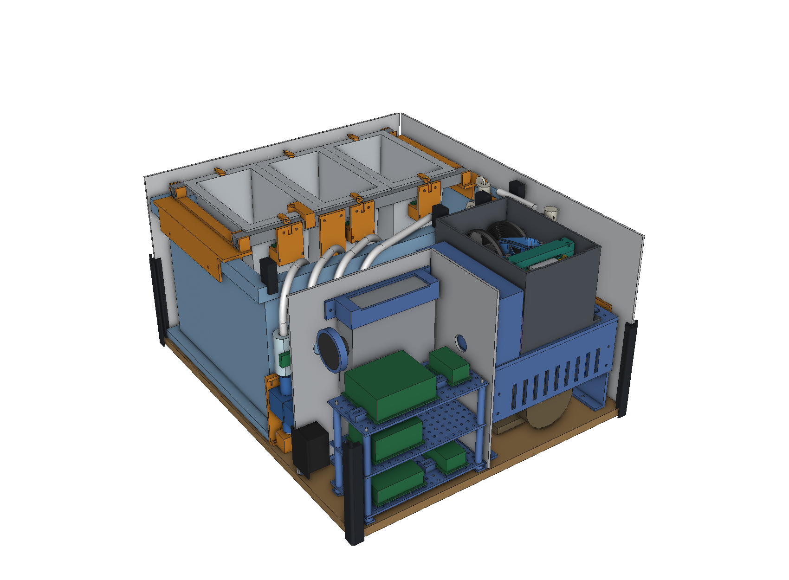

## Cosa cambia rispetto al rilascio 5

- **Scocca**: niente più vano a pannelli stampati. Pannelli di **Dibond da 3 mm** tagliati a misura (fianchi, frontale,
  retro, piano, paratia, divisorio), tenuti da **montanti d'angolo stampati** (D06/D07) e avvitati al bordo della base;
  coperchio del bagno in **plexiglass trasparente**. Tutti i pannelli hanno il loro DXF per il taglio.
- **Pescaggio dal basso**: ogni vaschetta ha un foro nel fondo con un **innesto a tenuta** (C11–C13): appoggiandola, il
  codolo entra nella **presa** sul fondo del bagno (C14), l'O-ring fa tenuta e un perno apre l'otturatore. Tolta la
  vaschetta, l'otturatore si richiude da solo. Le vaschette arrivano **a filo del coperchio**, il fondo si svuota fino
  a 16 ml.
- **Nessun foro sotto l'acqua del bagno per le linee**: le linee scavalcano il bordo del contenitore e scendono alle
  prese. Sotto l'acqua restano solo i riscaldatori e il rubinetto del bagno.
- **Svuotamento**: un **rubinetto per il bagno** (in basso sul pannello destro, svuota fin quasi al fondo) e, per le
  chimiche, l'**imbuto C20**: ci si appoggia sopra la vaschetta, infilato nella sua bottiglia, e l'otturatore
  dell'innesto si apre da solo. Vedi *Svuotare* sotto.
- **Riscaldatori distanziati**: uno verso il fronte e uno verso il retro della parete destra, ognuno col suo carter.
- **Sonda della chimica su un gancio** (C19) appoggiato al longherone: tiene la sonda dentro C1 e si toglie a mano.
- **Ingresso dell'acqua di rete**: passaparete, **flussimetro YF-S201**, sesta elettrovalvola e un beccuccio sopra il
  bagno con 26 mm d'aria sopra il troppopieno. Il bagno si riempie da solo, e il flussimetro dice se l'acqua arriva.
- **Sensori di livello tutti usati**: MIN e MAX del bagno, **MIN di ogni chimica** sulla camera di livello trasparente
  (C15) sopra la valvola, **MAX di ogni vaschetta** sulla sua parete (C04).
- **Troppopieno del bagno** con passaparete e tubo in PVC verso l'esterno.
- **Bagno più alto** (contenitore da 220 mm): 12,8 l al livello di lavoro, 10 riempimenti di riserva per i risciacqui.
- **Tank a filo del piano**: cavalletto rialzato, portagomma della tank orizzontale, apertura nel piano con due tacche
  per le dita e l'uscita della carta del 120.
- **Scivolo come la Lab-Box**: ognuna delle due slitte è un mezzo scivolo. All'imbocco, dal lato della barra, c'è
  il **cappuccio con il bordo a C**: suola sottile su cui scorre la pellicola (a 135 le due suole quasi si toccano al
  centro) e il labbro che copre il bordo della pellicola; lungo la spalla la gola si stringe e dentro le flange resta la
  linguetta sottile con la gola. Coda di pesce con le punte smussate a V. Si bloccano nelle due posizioni (135 stretta,
  120 larga) con una **vite zigrinata M3 × 10** nell'orecchia del mozzo, che entra in una fossetta della barra.
- **Spirale**: costole alte **2,5 mm** (erano 1,2: la pellicola poteva uscire dalla guida); **centro come la Lab-Box**:
  dal giro più interno la costola arriva dritta al mozzo con una sola curva di mezzo giro, e al centro resta uno spazio
  libero. **Una coppia di flange per formato**: 135 con 8 giri a 2,2 mm (180 cm di pellicola; un 36 pose è circa
  1,65 m), 120 con 5,5 giri a 3,1 mm (122 cm; un rullo 120 è circa 85 cm). Niente tamburo: la fascetta passa nel tubo
  **da parte a parte**, tra due collarini, con una finestra larga da un lato e una stretta dall'altro, come nella Lab-Box.
- **Alimentatore Mean Well LRS-350-12** (30 mm di spessore, ventola a temperatura) al posto del 12 V 30 A.
- **Display sul cruscotto inclinato** sopra il piano, invece che sul frontale.

## Come funziona

### Spirale (serie A)

Carico dal centro verso l'esterno: una fascetta con clip, che si avvolge direttamente sul tubo, tira la pellicola sulla
spirale. Costole alte 2,5 mm e centro come la Lab-Box, con la costola che dal giro più interno arriva dritta al mozzo
della flangia. Come nella Lab-Box c'è **una coppia di
flange per formato** (figura sotto): le **135** (A01, A02) hanno 8 giri a passo 2,2 mm, le **120** (A10, A11) 5,5 giri a
passo 3,1 mm, più distanziati perché la pellicola è larga quasi il doppio. Tubo, fascetta e anelli alette sono gli stessi.
Le flange si infilano sul tubo a baionetta e si bloccano con 30° di rotazione, fino al click della linguetta: le 135
nella stazione stretta, le 120 in quella larga. Per toglierle si gira con decisione nel verso opposto. Due anelli con alette muovono il liquido. Prima di tutto stampare il **provino A09**: ha tre giochi
(0,10 / 0,06 / 0,02 mm) per scegliere quello giusto per la stampante.

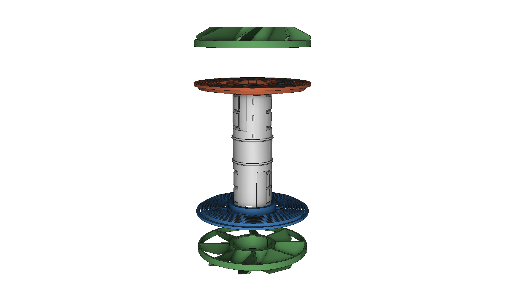

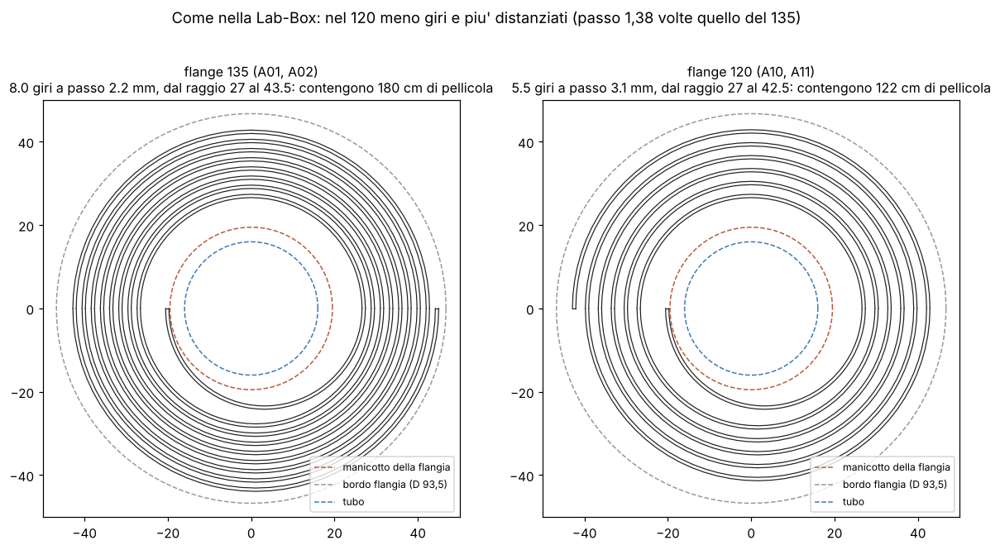

### Tank con caricatore (serie B)

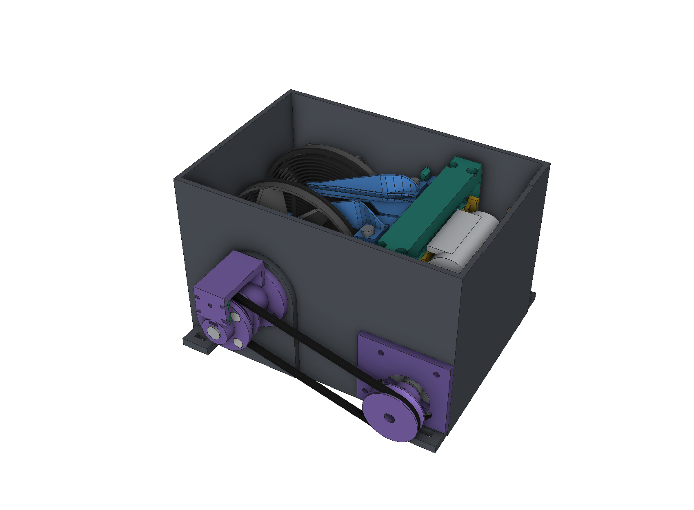

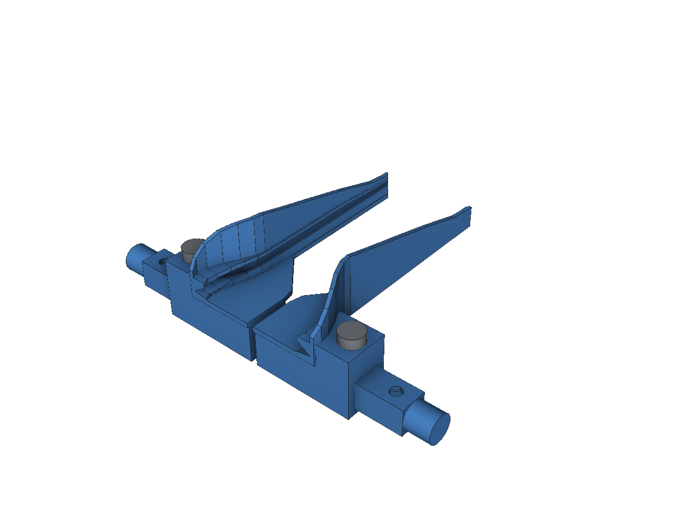

Dall'alto, come nelle foto della Lab-Box: a 135 le due slitte unite al centro, a 120 distanziate sulla barra.

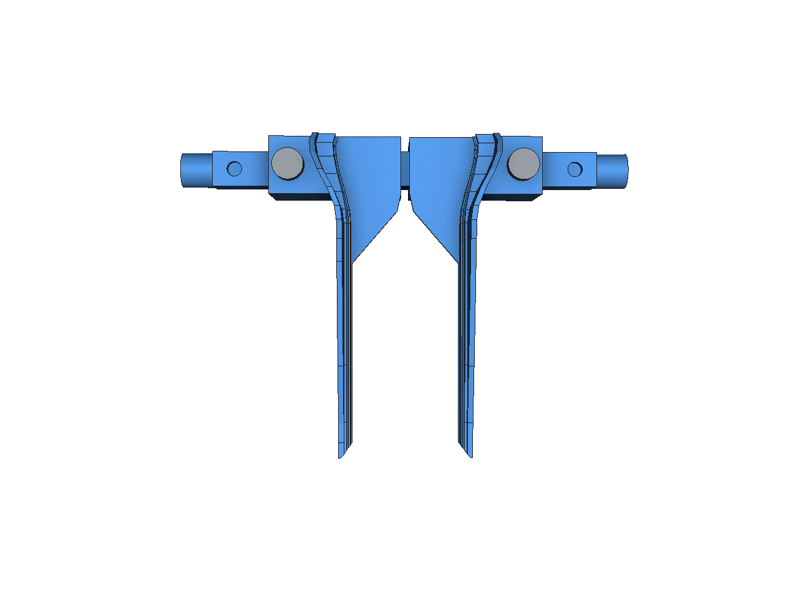

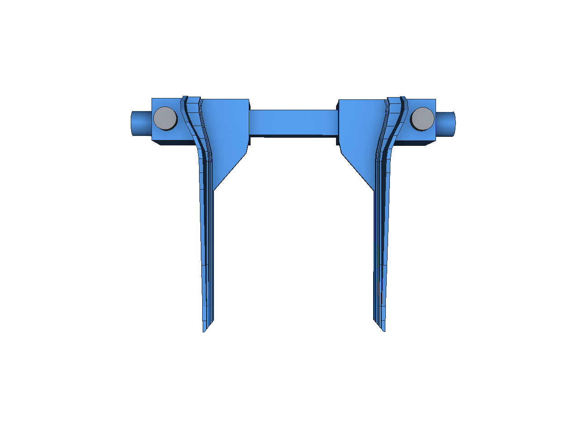

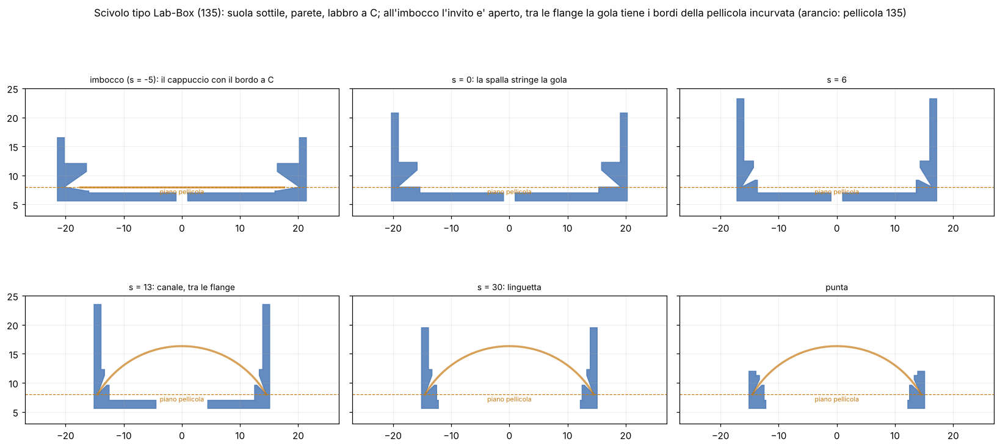

Corpo in un pezzo solo, stampato in piedi. Dentro: la vasca della spirale e, separato da un divisorio, il ripiano
asciutto con culla, ponte, taglierina e guida. Sotto il ripiano la galleria del motoriduttore e il vano del servo.
La bocca della tank sta nell'apertura del piano anteriore, a filo.

- **Trasmissione**: motoriduttore 20 giri/min → cinghia tonda (un O-ring 80 × 3) → albero inox Ø8 su due cuscinetti con
  paraolio. La cinghia fa anche da limitatore di coppia: quando la pellicola finisce slitta.
- **Sensore Hall**: quattro magneti sulla puleggia della spirale.
- **Liquido**: entra ed esce da un pescante che sale sopra il livello: nessun foro sotto il liquido. Con 250 ml il
  livello è a 34 mm dal fondo, con 350 ml a 46 mm; l'asse è a 50 mm. Oltre circa 500 ml il liquido esce dal troppopieno.
  Il portagomma ora è orizzontale e il tubo in silicone nero sale con una curva larga fuori dal cavalletto.
- **Scivolo**: due slitte su una barra quadra, come nella Lab-Box. Fuori dalle flange ogni slitta è un mezzo scivolo:
  all'imbocco il cappuccio con il bordo a C, con la suola sottile e il labbro che copre il bordo della pellicola; lungo
  la spalla la gola si stringe. Dentro le flange resta solo la linguetta con la gola, che sta 0,2 mm dentro le punte
  delle costole e incurva la pellicola (gobba in alto) quanto basta per farla passare sopra le costole dei giri esterni:
  con le costole da 2,5 mm il 135 si incurva con un raggio di circa 17 mm (8 mm di freccia), il 120 di circa 40 mm.
  A spirale piena restano 2,15 mm sotto il coperchio e lo spigolo del cappuccio passa a 0,9 mm dal tetto del ponte (per
  questo la parete del cappuccio è bassa all'imbocco). Per cambiare formato: allentare le due viti zigrinate, spostare
  le slitte nell'altra fossetta, stringere a mano.
- **Fascetta**: quella della Lab-Box, comprata già fatta. Passa nel tubo A03 da parte a parte, tra i due collarini: si
  infila dalla finestra larga e dalla finestra stretta, dal lato opposto, passa solo la fascetta; il perno sul suo capo
  resta dentro, contro la finestra stretta. All'altro capo la clip, che a fine caricamento resta avvolta sul tubo sotto
  la pellicola, come nella Lab-Box. Le misure delle finestre sono in `verifiche.txt`.
- **Luce**: coperchio a labirinto; sul lato del caricatore una feritoia lascia uscire la carta del 120.

### Bagno e vaschette (serie C)

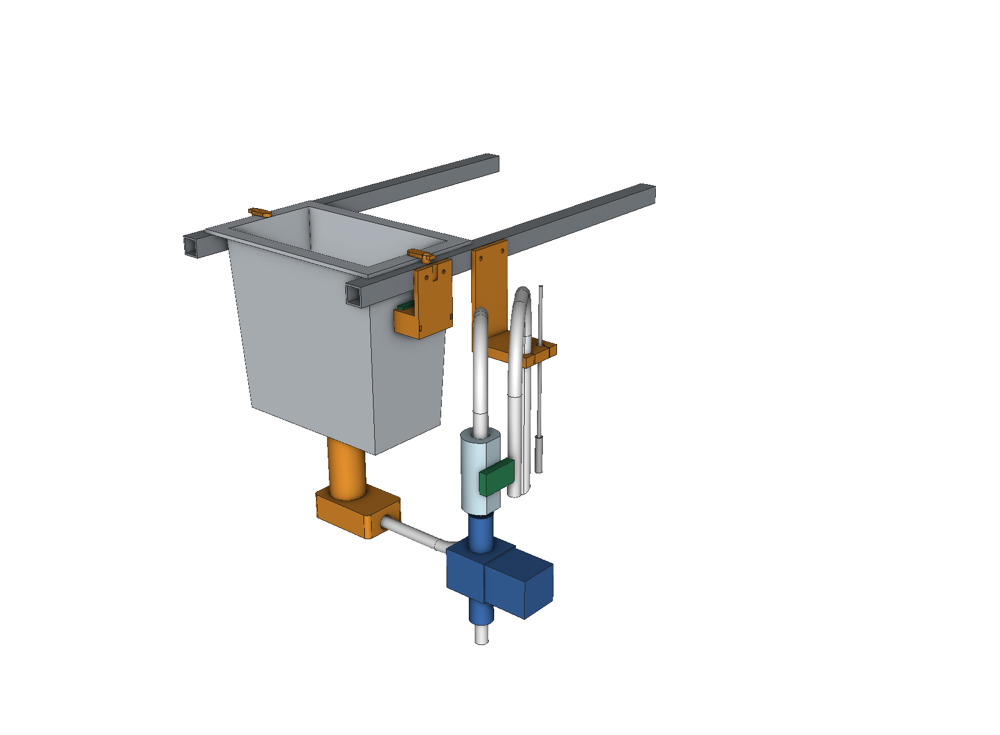

Le vaschette sono normali bacinelle Gastronorm GN 1/9 alte 150 mm in polipropilene, con un foro Ø16,4 al centro del
fondo. Nel foro va l'innesto:

- **C11**, il corpo: flangia sottile dentro la vaschetta (sul fondo) con una crociera, e gambo filettato M16 × 2 che
  attraversa il fondo; sotto la flangia una guarnizione piana in EPDM.
- **C12**, la ghiera: dado esagonale da 24 che stringe il fondo, e codolo Ø16 con un O-ring 13 × 2. Dentro c'è la
  sede conica dell'otturatore.
- **C13**, l'otturatore: chiuso da una molla, con un O-ring 6 × 1,5 sulla sede e un naso che sporge dal codolo.
- **C14**, la presa: pesante, appoggiata sul fondo del bagno sotto ogni vaschetta. Ha un invito largo che centra la
  vaschetta entro ±5 mm, la sede del codolo e un perno che apre l'otturatore.

Mettendo giù la vaschetta l'O-ring entra in tenuta **11 mm prima** della fine della corsa, il perno apre l'otturatore
solo negli ultimi **3,5 mm**: quando si apre la tenuta c'è già. La vaschetta può stare fino a 8 mm più in alto senza
perdere la tenuta. Sollevandola succede il contrario: l'otturatore si chiude prima che l'O-ring esca.

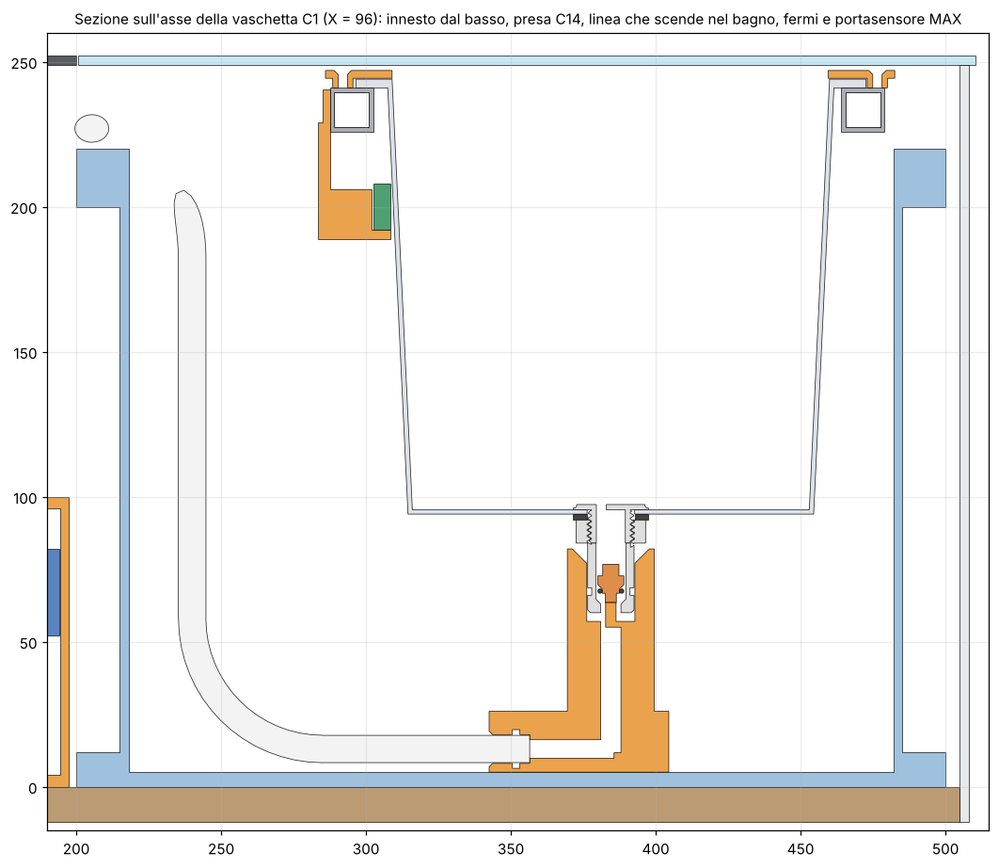

- **Fermi girevoli** (C03), davanti e dietro ogni vaschetta: una leva sopra il bordo. Una vaschetta vuota immersa
  galleggia con circa 6 N: i fermi la tengono giù. Per toglierla si girano i due fermi parallelamente al longherone e
  si solleva in verticale.
- **Sensore MAX** (C04): sotto il longherone anteriore, contro la parete della vaschetta, sopra l'acqua del bagno. Si
  bagna quando nella vaschetta c'è circa 1 litro.
- **Sonde di temperatura** (in rosso nella vista qui sotto): quella del **bagno** sta nel portasonde C06, avvitato al
  longherone anteriore tra C1 e C2, insieme al pescante dell'acqua; pesca nella fascia davanti alle vaschette, a metà
  altezza, dalla parte opposta ai riscaldatori. Quella della **chimica** pesca dentro la vaschetta C1: il cavo passa nella
  manica del **gancio C19**, che sta a cavallo del longherone anteriore e passa sopra il bordo della vaschetta, sotto il
  coperchio. Per togliere C1 si solleva prima il gancio con la sonda.
- **Riscaldatori** (in arancio): due cartucce da 100 W nella parete destra, a 27 mm dal fondo, **una verso il fronte e
  una verso il retro** (180 mm di distanza), sotto le vaschette. Così il calore sale in due punti lontani invece che
  in uno solo. Ognuno ha il suo carter C10.

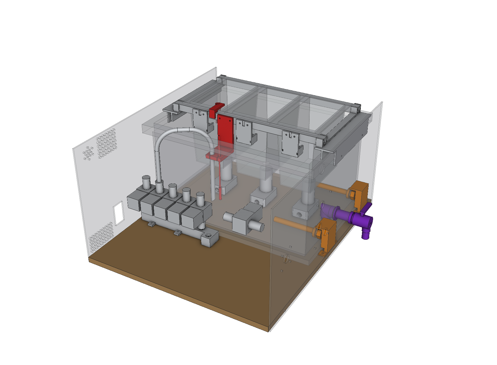

Il bagno contiene **12,8 litri** al livello di lavoro (vaschette immerse per 71 mm). Fornisce anche l'acqua dei
risciacqui: ogni litro prelevato abbassa il livello di 16 mm e tra il livello di lavoro e il sensore MIN ci sono 3,5
litri, cioè 10 riempimenti da 350 ml. Il pescante dell'acqua pesca più in alto dei riscaldatori, quindi la pompa non
può scoprirli. Il troppopieno comincia a 174 mm, 6 mm sopra il sensore MAX.

### Idraulica

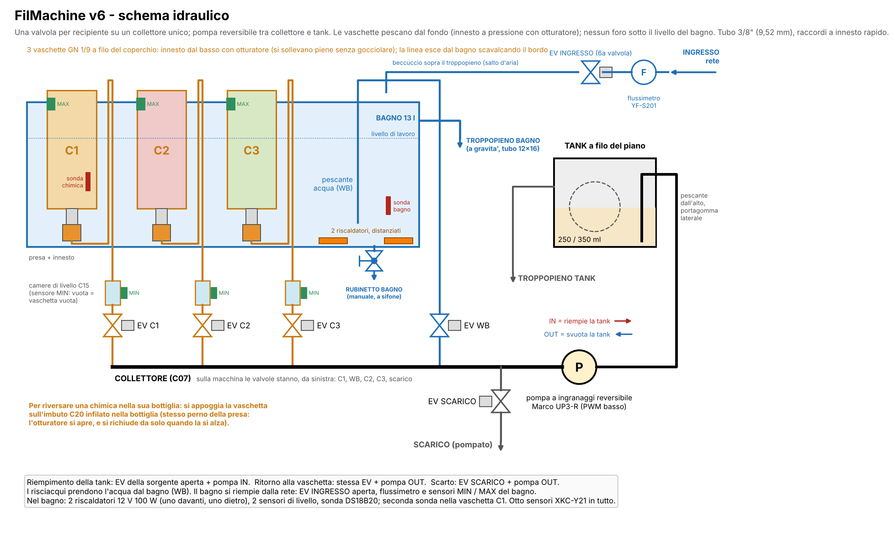

Una valvola per recipiente, tutte su un collettore; la pompa reversibile sta tra il collettore e la tank. È lo schema
che il firmware usa già per il processo.

- **Dalle valvole alle vaschette** (C1, C2, C3): sopra ogni valvola c'è la **camera di livello C15**, un tratto di
  linea in PETG trasparente con il sensore MIN. Dalla camera un tubo da 3/8" in un pezzo solo sale a 182 mm, scavalca
  il bordo del contenitore con curve di raggio 45 mm, scende nella fascia anteriore del bagno e con una curva sul fondo
  entra nella presa C14. La linea fa da sifone: una volta piena resta piena; quando la vaschetta è vuota la pompa
  aspira aria e la camera si svuota (vedi `docs/note_firmware.md`, punto 1.2).
- **WB**: un tubo solo, a ponte come le linee, fino al pescante nel portasonde C06.
- **Scarico**: un gomito sopra la valvola; il tubo corre nella rientranza del contenitore fino al passaparete SCARICO.
- **Collettore → pompa → tank**: gomito a codolo nella sede del collettore; dalla pompa un tubo attraversa il fianco
  del cavalletto, un gomito, la salita fuori dal cavalletto e la curva in silicone nero sul portagomma della tank.
- **Ingresso dell'acqua**: passaparete INGRESSO → flussimetro → due gomiti → valvola dell'ingresso → gomito → salita
  attraverso il piano del cavalletto → tratto sopra il bordo del bagno → beccuccio (staffa C17). Flussimetro e valvola
  stanno sotto il piano del cavalletto, legati con una fascetta alle staffe C18.
- **Troppopieni**: quello della tank va con un silicone diritto, in discesa, alla piastra degli scarichi; quello del
  bagno è un passaparete nella parete del contenitore con un tubo in PVC 12 × 16. Le taniche devono stare più in basso.
- **Rubinetto del bagno**: un passaparete da 1/2" a filetto lungo attraversa la parete del contenitore (in basso, tra i
  due riscaldatori) e il pannello destro; fuori c'è un rubinetto a sfera con portagomma, dentro un gomito con un corto
  pescante che arriva a 4 mm dal fondo. Con un tubo che scende in un secchio sotto il tavolo, il bagno si svuota per
  sifone: restano sul fondo circa 0,4 litri.
- **Niente rubinetti sulle linee delle chimiche**: le linee scavalcano il bordo del bagno, quindi un rubinetto su una
  linea starebbe più in alto del fondo della vaschetta e non la svuoterebbe. Per riversare una chimica nella sua
  bottiglia c'è l'imbuto C20 (sotto).

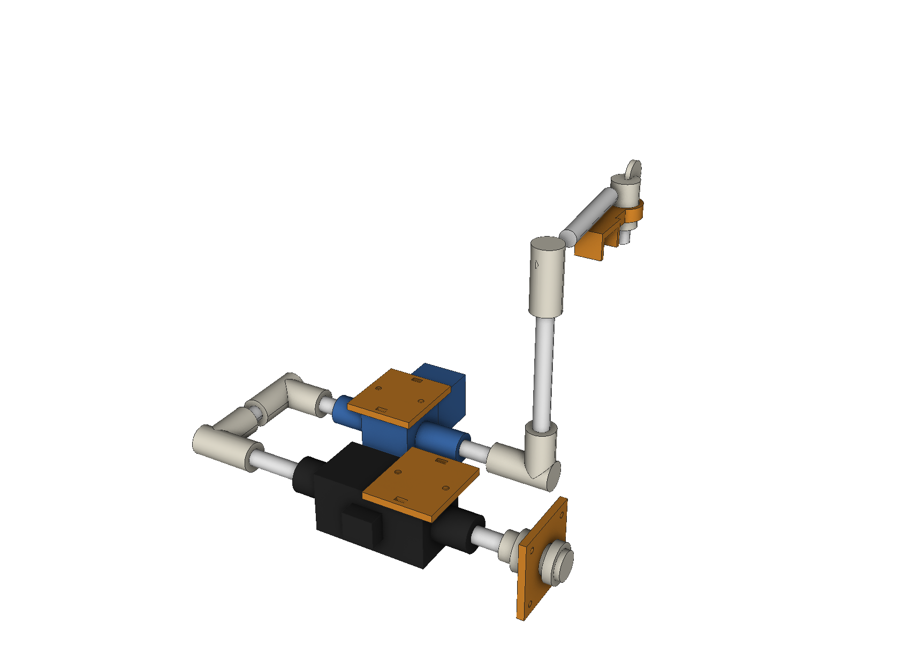

### Elettronica (serie D)

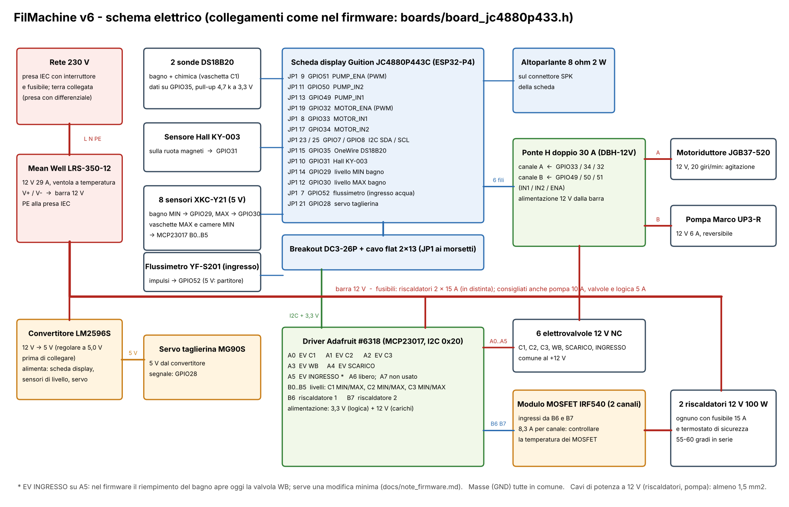

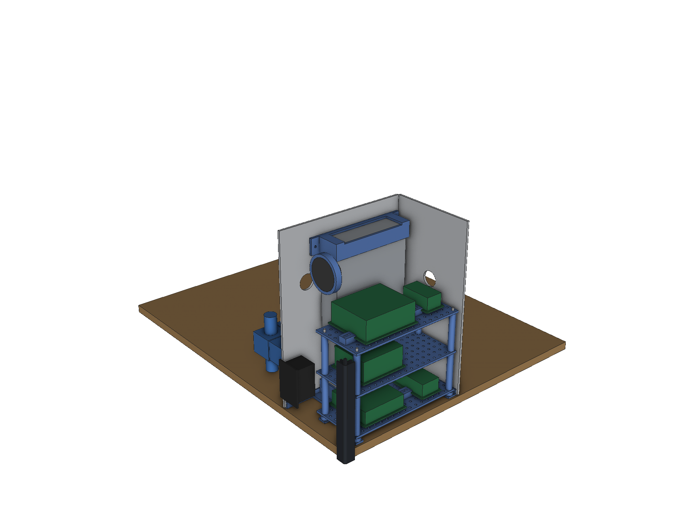

L'alimentatore LRS-350-12 sta in piedi nello zoccolo D16 contro la paratia, sollevato di 10 mm perché l'aria entri da
sotto, ed è tenuto in alto dalla staffa D17. Davanti, tre ripiani a griglia su quattro barre filettate M3:
- **basso**: modulo IRF540 dei riscaldatori e convertitore LM2596 (vicino alle griglie d'aria del fianco sinistro);
- **centrale**: ponte H doppio (motore e pompa);
- **alto**: breakout e driver MCP23017, così il flat da 20 cm arriva al display attraverso la fessura del piano.

La presa IEC è sul fianco sinistro, l'altoparlante dietro la foratura dello stesso fianco. Paratia e divisorio in
Dibond separano l'elettronica da valvole e cavalletto; si infilano nelle guide a U D11 avvitate alla base.

### Scocca

Base in multistrato 420 × 505 × 12. Ai quattro angoli i **montanti** (D06 sotto, D07 sopra, uniti da un tenone) hanno
due fessure in cui entrano le teste dei pannelli. I quattro pannelli verticali si avvitano al bordo della base con tre
viti svasate nere ciascuno. Il **piano anteriore** (antracite) appoggia sui montanti e, dietro, sui quattro appoggi D08
che stanno sulla fascia del contenitore; il **coperchio trasparente** appoggia sugli stessi appoggi e sui montanti
posteriori, e si solleva dalla tacca nel piano. Il **cruscotto** D09 è avvitato da sotto il piano con quattro viti; il
display entra nella cornice dietro la finestra ed è trattenuto da quattro linguette girevoli D10.

## Uso

**Caricare un 135**
1. Aprire il coperchio della tank. Flange 135 (A01, A02) sul tubo, nella stazione stretta. Slitte nella posizione
   stretta (fossetta interna), viti zigrinate strette.
2. Caricatore nella culla; tirare fuori 10 cm di coda, passarla nella fessura del ponte e infilarne i bordi sotto i
   labbri dell'invito, poi lungo le slitte fino alla clip, e agganciarla.
3. Chiudere e avviare il caricamento. A fine rullino la spirale si ferma, la cinghia slitta, la lama taglia.

**Caricare un 120**
1. Flange 120 (A10, A11) sul tubo, nella stazione larga. Slitte nella posizione larga. Rullo nella culla.
2. Svolgere la carta finché compare la pellicola; agganciarla alla clip e far uscire la carta dalla feritoia sul lato
   del caricatore.
3. Chiudere e avviare, accompagnando la carta. Alla fine la lama taglia la pellicola prima del nastro.

**Bagno**: con l'ingresso collegato al rubinetto (meglio acqua già tiepida dal miscelatore) e le modifiche al firmware
di `note_firmware.md` punto 1.1, il bagno si riempie da solo fino al sensore MAX. Senza, si versa dalla tacca del
coperchio. Da 20 a 38 °C i due riscaldatori impiegano circa 99 minuti; da 33 °C circa 28.

**Vaschette**: riempirle fuori dalla macchina (circa 1 litro, fino a 98 mm dal fondo), appoggiarle sulle prese, premere
giù e chiudere i due fermi. Al primo processo la pompa adesca le linee.

**Sviluppo**: come oggi nel firmware. *Volume chimica = Basso* e tank *Piccola* (250 ml) o *Media* (350 ml).

**Svuotare**
- *Bagno*: infilare un tubo 12 × 16 sul portagomma del rubinetto destro, metterlo in un secchio più in basso della
  macchina e aprire il rubinetto.
- *Una chimica nella sua bottiglia*: infilare l'**imbuto C20** nel collo della bottiglia, aprire i fermi, sollevare la
  vaschetta e appoggiarla sull'imbuto. Il codolo entra nella sede dell'imbuto (stesso O-ring e stesso perno della presa
  nel bagno), l'otturatore si apre e la chimica scende nella bottiglia; sul fondo restano circa 16 ml. Alzando la
  vaschetta l'otturatore si richiude: niente gocce. Le due scanalature sul cono fanno uscire l'aria dalla bottiglia.
  Un solo imbuto serve per tutte e tre le vaschette, senza software.

  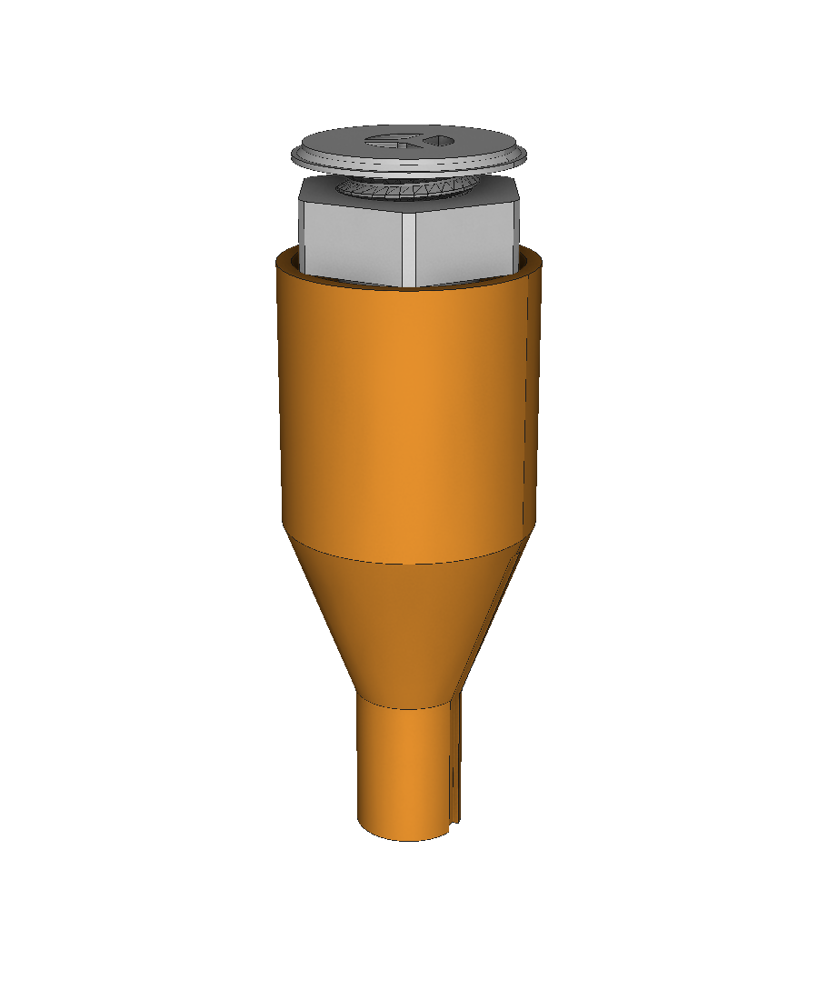

**Fine lavoro**: aprire i fermi e sollevare le vaschette (l'innesto si chiude da solo), lavarle; far girare un processo
di sola acqua per sciacquare tubi, pompa e tank.

## Stampa

- **Materiale**: PETG. Spirale, tank e coperchio della tank in **nero** (tenuta alla luce); le camere di livello C15 in
  **PETG trasparente**; il resto come si vuole (montanti e cruscotto stanno bene antracite come il piano).
- Ugello 0,4, strato 0,2, 3–4 perimetri, riempimento 25 %. **A 4 perimetri e 100 %**: collettore C07, innesti C11 e C12,
  prese C14 (devono pesare), imbuto C20; otturatore C13 e camere C15 al 100 %.
- Tutti i pezzi sono già orientati e stanno su un piatto da 256 × 256. Vogliono i supporti **solo** B17 (sotto la
  flangia) e le slitte B14/B15 (stampate in piedi sulla coda, supporti solo dal piatto sotto il mozzo e il cappuccio). Le testate C05 si stampano in piedi
  (202 mm): brim consigliato. Negli altri pezzi ci sono solo ponti corti (elenco in `verifiche.txt`).
- Elenco, quantità, ingombri e note pezzo per pezzo: foglio *Pezzi stampati* della distinta. In tutto circa 1,7 kg di
  filamento.

## Montaggio, in ordine

1. **Base**: tagliare il multistrato 420 × 505, incollare sopra la dima stampata 1:1 (controllare il segmento da
   100 mm) e segnare i fori: preforo Ø2,5 non passante, viti da legno 3,5 × 12. I quattro fori del piede della pompa si
   segnano dalla pompa stessa.
2. **Bagno**: tre fori nella parete corta destra del contenitore (posizioni in `verifiche.txt`): due Ø16,5 per i
   riscaldatori, uno Ø22 per il passaparete del troppopieno, uno Ø21,5 per il rubinetto. Riscaldatori con guarnizione
   dentro e fuori, un carter C10 ciascuno. Il rubinetto del bagno si monta dopo il pannello destro (attraversa tutti e due).
   Incollare i due sensori di livello all'esterno della parete anteriore (MIN a 110 mm, MAX a 168 mm dal piano).
3. **Vaschette**: foro Ø16,4 al centro del fondo (punta a gradino, poi sbavare). C11 dall'interno con la guarnizione
   sotto la flangia, molla e otturatore C13 con il suo O-ring, ghiera C12 da fuori stretta a mano. O-ring 13 × 2
   ingrassato sul codolo.
4. **Telaio delle vaschette**: tagliare due longheroni da 356 mm, infilarli nelle testate C05, appoggiare il telaio sul
   contenitore e stringere le viti M4 sotto la fascia. Sui longheroni: fermi girevoli C03, portasensori C04, portasonde
   C06 (posizioni in `verifiche.txt`; viti per lamiera 2,9 con preforo da 2,4).
5. **Valvole**: collettore sulla base, O-ring ingrassati, cinque spezzoni da 33 mm, valvole (freccia dalla vaschetta
   verso il collettore), pettine C08 e una fascetta per valvola. Sopra C1, C2, C3 uno spezzone da 34 mm e la camera C15
   col suo sensore.
6. **Pompa e cavalletto**: pompa con i due raccordi filettati; flussimetro e valvola dell'ingresso legati alle staffe
   C18 sotto il piano del cavalletto; fianchi, piano e frontale del cavalletto.
7. **Tank**: montare trasmissione, perno folle, servo, ponte, culla e guida; poi la tank sul cavalletto con quattro viti.
8. **Tubi**: tagliarli secondo la tabella in `verifiche.txt`; i tubi a ponte un po' abbondanti, da rifilare sul posto.
   I due tubi in silicone che arrivano alla tank devono essere **neri**. Prese C14 sul fondo del bagno, linee innestate.
9. **Elettronica**: guide D11, zoccolo e alimentatore, colonna dei ripiani, schede, paratia e divisorio. Cablare secondo
   lo schema.
10. **Scocca**: montanti inferiori, pannelli verticali (tre viti ciascuno nel bordo della base), montanti superiori,
    appoggi D08 sulla fascia del contenitore, piano anteriore, cruscotto con il display, coperchio trasparente.
    Le viti, una per una, sono nel foglio *Viteria* della distinta.

## Misure da controllare sui componenti veri

Alcuni componenti non li ho potuti misurare. Le quote usate sono in `src/machine.py`; se le tue sono diverse basta
cambiarle e rigenerare.

| Componente | Quota assunta | Dove pesa |
|---|---|---|
| Vaschetta GN 1/9 h150 | bordo largo 11 mm e spesso 3 mm, parete 1,5 mm, sformo 7 mm, fondo piano | innesto C11/C12, fermi C03, portasensore C04 |
| Contenitore Euro 400 × 300 × 220 | interno 364 × 264 × 215 mm, fascia di rinforzo alta 20 mm | testate C05, appoggi D08, lunghezza dei longheroni |
| Elettrovalvola | 82 mm tra gli attacchi, corpo 33 mm, bobina di lato | passo del collettore (35 mm), pettine C08, staffa C18 |
| Flussimetro YF-S201 | 65 mm tra le estremità, attacchi 1/2" maschio | staffa C18, tagli dell'ingresso |
| Pompa UP3-R | attacchi sui due fianchi della testa, a 41 mm dal piano | altezza del tubo verso il collettore |
| Riscaldatore | filetto M16, esagono 22 | fori nel contenitore, carter C10 |
| Alimentatore LRS-350-12 | 215 × 115 × 30 mm, morsetti su un lato corto | zoccolo D16, staffa D17 |
| Scheda display | 114,4 × 66,8 × 3,2 mm; finestra 96 × 58 centrata sulla scheda | cruscotto D09, linguette D10 |
| Schede | ingombri indicativi | solo la disposizione sui ripiani |

## Verifiche fatte sul modello

Dettagli e numeri in `verifiche.txt`.

- **Assieme**: tutti i corpi (pezzi stampati, componenti acquistati e scocca) sono solidi validi e **nessuna coppia
  interferisce** (le sovrapposizioni volute, come un tubo infilato nel suo raccordo, sono elencate nel codice). Tutti gli
  STL sono chiusi.
- **Viti**: ogni foro passante ha di fronte, sullo stesso asse, il suo foro filettato; attorno ai fori filettati la
  parete è piena; la lunghezza di ogni vite è confrontata con la profondità del foro.
- **Vaschette**: estrazione e inserimento in verticale senza urti per tutte e tre, con i fermi aperti; fasi
  dell'innesto (tenuta prima dell'apertura), schiacciamento dell'O-ring 14 %, passaggio dell'otturatore aperto 27 mm²
  (quasi quanto il tubo).
- **Volumi e livelli**: vaschette, bagno, riserva per i risciacqui, distanze di sensori e troppopieni, salto d'aria del
  beccuccio, galleggiamento e sforzo nei fermi (3 MPa).
- **Spirale, taglierina, culla**: come nel rilascio 5. Le due coppie di flange (135 e 120) si montano sul tubo senza
  interferenze e hanno le costole in fase tra lato A e lato B. **Scatto della baionetta**: a blocco inserito il dentino è
  libero nella gola; girando verso lo sblocco tocca lo scalino dopo circa 1° e dopo 3–5° la linguetta è flessa del tutto
  (flange e anelli alette, lato A e lato B); la gola c'è solo nelle stazioni, dove arriva il dentino. **Fascetta**: le
  due finestre del tubo sono passanti da parte a parte e una di fronte all'altra; il perno della fascetta passa dalla
  larga e non dalla stretta; al centro del tubo non entra niente (trascinatore e perno folle arrivano solo alle
  estremità).
- **Guida**: nessun urto da spirale vuota a piena, nei due formati; a spirale piena restano 2,15 mm sotto il coperchio.

## Cosa non è verificato e va provato

1. **Niente è stato costruito.** Forze, attriti e tenute sono stimati.
2. **Innesto dal basso**: tenuta dell'O-ring nel codolo stampato, tenuta della guarnizione sul fondo della vaschetta
   (il fondo in polipropilene deve essere piano attorno al foro), chiusura dell'otturatore con una molla debole.
   Provare prima una vaschetta piena d'acqua fuori dalla macchina, su una presa appoggiata in una bacinella.
3. **Tenuta alla luce della tank**: labirinto del coperchio, feritoia della carta, tubi.
4. **Formazione dell'arco della pellicola** nello scivolo: è il punto più delicato del caricatore. Con le costole da
   2,5 mm il 135 deve incurvarsi con un raggio di circa 17 mm per passare sopra le costole dei giri esterni (con 1,2
   mm bastavano 23 mm): provarlo a mano con uno spezzone di pellicola di scarto, flange e slitte stampate, prima del
   resto. Se la pellicola non entra bene, 2,0 mm sono un compromesso (è un solo numero, `RIB_H` in `common.py`).
   Provare anche il cappuccio: la coda deve infilarsi sotto i labbri senza piegarsi. Le flange 120 vanno provate allo
   stesso modo con uno spezzone di 120; il passo è un solo numero (`SPIRALS` in `src/reel.py`).
5. **Fascetta nel tubo**: provarla sul tubo stampato prima di montare le flange: il piolino deve passare dalla finestra
   larga (3,6 mm per un piolino da 3,25: se la stampa la stringe troppo, si allarga con una limetta o si alza
   `STRAP_WIN_W` in `src/reel.py`) e non deve passare dalla stretta (2,5 mm). **Click della baionetta**: la forza per svitare è stimata. Se è troppo duro, si abbassa l'angolo dello
   scalino (`DET_STEEP` in `common.py`, oggi 70°); se è troppo morbido, si alza il dentino (`BUMP_H`, oggi 0,55 mm).
6. **Coppia di slittamento della cinghia** e **forza di taglio** (il servo dà circa 28 N sul portalama).
7. **Collettore e camere stampati**: tenuta degli O-ring e porosità della stampa.
8. **Elettrovalvole**: sono a membrana e il liquido le attraversa nei due versi. La prova di soffio con la valvola chiusa
   è passata; la tenuta con il liquido in pressione inversa va provata.
9. **Curve dei tubi**: il raggio di 45 mm per il tubo da 3/8" è prudente ma non provato.
10. **Sensori XKC-Y21 sulla camera C15**: devono vedere il liquido attraverso la parete di PETG trasparente: provarli
   con acqua prima di montare (sono fatti per pareti fino a qualche millimetro, ma non su questo materiale).
11. **Pompa**: molto più grande del necessario, corpo in ottone nichelato: usarla lenta e sciacquarla.
12. **Firmware**: il processo funziona com'è; per l'ingresso dell'acqua servono le due piccole modifiche di
    `docs/note_firmware.md` (punto 1.1); pulizia, svuotamento e autotest dei flussi come prima (punti 3 e 4).
13. **Riscaldatori**: non devono mai lavorare a secco; il modulo IRF540 a 8,3 A per canale scalda: dissipatori e
    controllo della temperatura alla prima prova lunga.
14. **Riscaldamento lento**: 12,8 litri da 20 a 38 °C richiedono circa un'ora e mezza; riempire con acqua tiepida.
15. **Il 120 resta semi-manuale**: la carta va accompagnata a mano.
16. **PDF 3D**: si naviga solo con Adobe Acrobat Reader su computer.

## Sicurezza elettrica

La rete a 230 V entra solo nell'alimentatore, dentro il vano chiuso da pannelli. Collegare la terra (anche ai pannelli
di Dibond, che sono di alluminio: un capocorda con rondella dentellata sotto una vite del pannello sinistro, che
incida la vernice), usare una presa protetta da
differenziale e tenere chiusa la macchina quando è alimentata: accanto ci sono acqua e chimica. Tutto il resto lavora a
12 V. È un progetto amatoriale, non certificato.

## Rigenerare i file

```
cd src
sh all.sh /percorso/IDTFConverter   # tutto in una volta; oppure, un passo alla volta:
python3 build_all.py            # pezzi STEP/STL, verifiche, pannelli DXF, assieme STEP
python3 previews.py             # viste e sezioni
python3 schemi.py && python3 dima.py && python3 make_bom.py
python3 make_pdf3d.py /percorso/IDTFConverter
```

Servono Python con CadQuery 2, VTK, matplotlib, openpyxl; per il PDF 3D anche `IDTFConverter`
(github.com/ningfei/u3d) e LaTeX con il pacchetto `media9`.
