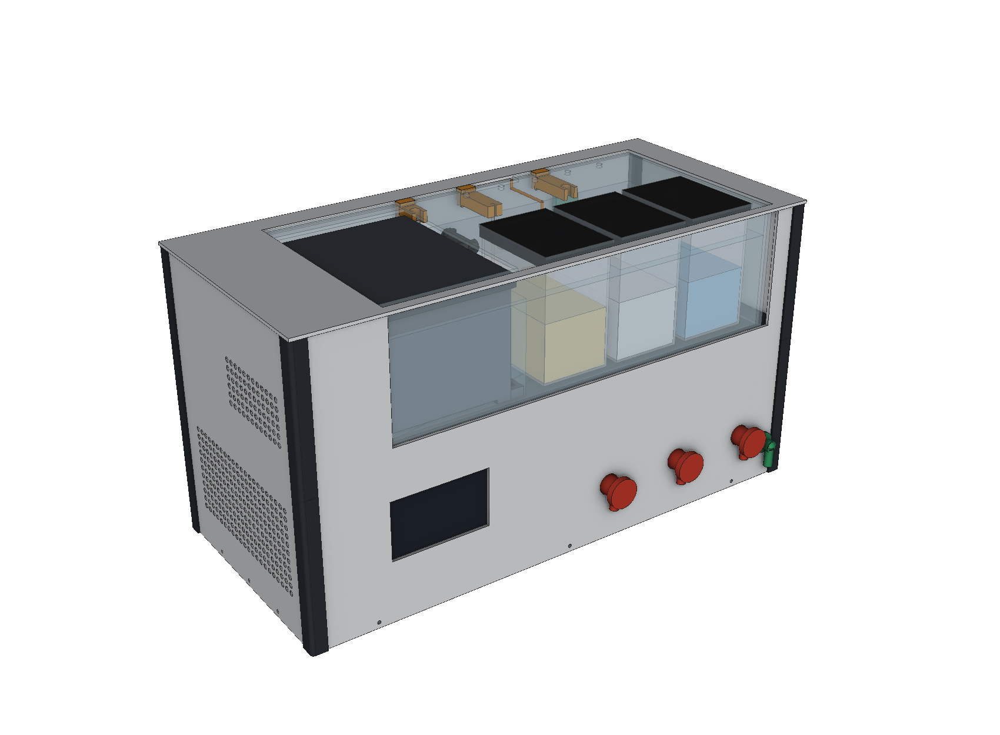
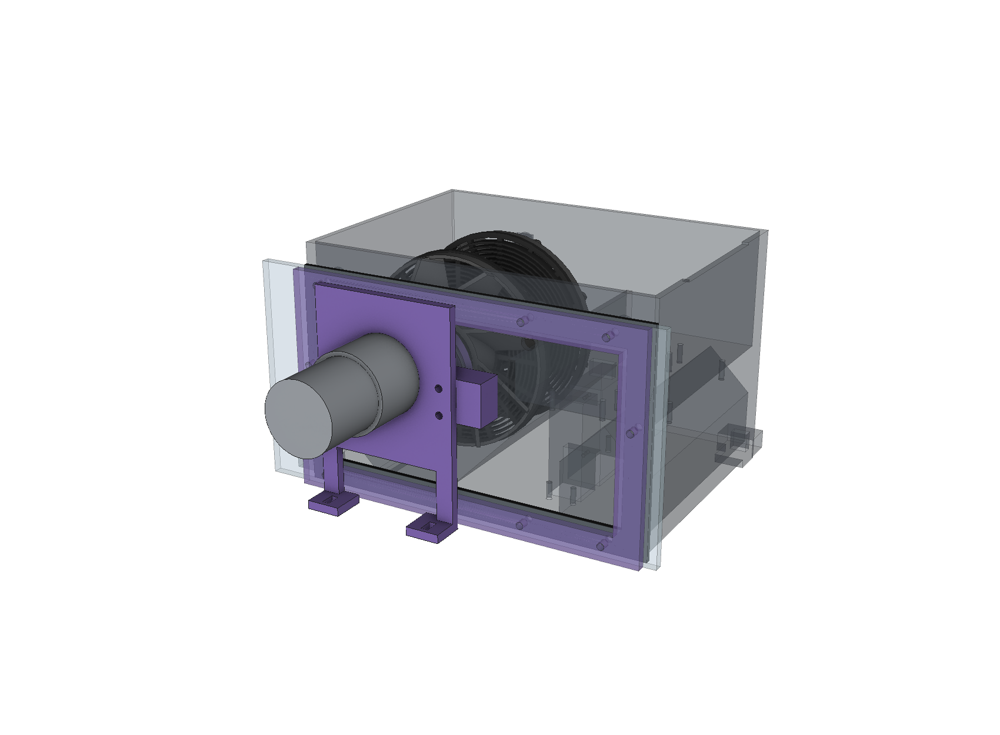

# FilMachine – macchina completa (rilascio 7)

Progetto meccanico di tutta la macchina, rifatto sul concept «Film Flow»: **tank immersa nel bagno** (niente fase di
tempera, la chimica entra nella tank alla temperatura del bagno), **trascinamento magnetico** della spirale attraverso la
testata (nessun albero passante, nessun paraolio), **tre contenitori da 500 ml in fila e a vista** dietro la parete
anteriore trasparente del bagno, pompa peristaltica Kamoer su un collettore a sei valvole, uscita di RECUPERO sul fronte,
display 4,3" orizzontale sul piedistallo.
Usa i componenti già acquistati (display, Kamoer, Mainboard v1.1, motoriduttore, riscalda­tori da 100 W, cinque valvole,
sensori) e i collegamenti del firmware `FilMachine_Reworked` v7.

**È un progetto, non una macchina provata.** Tutto quello che segue è verificato sul modello 3D (interferenze, viti,
volumi, movimenti della taglierina e della spirale); niente è stato stampato né misurato. I punti da provare a banco
sono in fondo. Le misure dei componenti comprati che contano (contenitori da 500 ml, passaparete 3/8", filetto delle
cartucce, Kamoer) sono quelle ipotizzate in `src/machine.py`: **vanno confermate sui pezzi veri prima di tagliare
pannelli e piano**.

## Ingombro

**526 × 232 mm in pianta, 276 mm sopra la base** (pannelli da 3 mm esclusi: 532 × 238; base in multistrato 12 mm e
piedini sotto). Acqua nel bagno: **3,0 litri** (tolto tutto quello che è immerso) con il livello a 91 mm dal fondo. Rispetto al rilascio 6 (420 × 505 × 261)
la macchina è più larga e meno profonda: tutto quello che serve dal fronte (display, contenitori, rubinetti, recupero)
sta sul fronte, il retro ha solo gli attacchi.

## Com'è fatta

| Zona | Cosa c'è |
|---|---|
| **Piedistallo** (alto 150, pannelli Dibond, piano in multistrato) | a sinistra l'alimentatore LRS-350-12 in piedi, davanti il display con la Mainboard subito dietro, poi flussimetro e valvola dell'ingresso, la Kamoer; a destra, sul retro, il collettore C01 con le **sei valvole sdraiate** (da sinistra WB, C1, SCARICO, C2, RECUPERO, C3) e davanti a C1, C2, C3 le **camere di livello** C03 sotto i passaparete dei contenitori; sul fronte i tre rubinetti a margherita e l'uscita RECUPERO |
| **Bagno** (PMMA 4 mm incollato, sul piano) | a sinistra la **tank** (quella del rilascio 6, senza trasmissione) appoggiata sul fondo su piedini di 4 mm, con la testata sulla finestra della parete sinistra; a destra i **tre contenitori** da 500 ml, fissati al fondo dal proprio passaparete; dietro i contenitori la striscia di servizio: le due **cartucce da 100 W** infilate dalla parete destra, la **sonda**, la **pompetta di ricircolo**, i passaparete di **WB** (pescante, vicino alla parete posteriore) e **troppopieno** (tubo verticale a filo dell'acqua); tra la tank e C1, vicino alla parete posteriore, i passaparete dell'**ingresso** (beccuccio sopra l'acqua: salto d'aria) e della **linea tank**. Coperchio in PMMA 3 mm aperto sulla tank e sui tappi |
| **Vano asciutto** (a sinistra del bagno, sopra il piedistallo) | il **motoriduttore JGB37-520 coassiale** con la spirale sulla staffa B20, il disco magnetico B18 nell'incavo della testata, il **Hall** sulla staffa B21 a sinistra del disco (sull'asse), la **cornice** B22 che stringe la testata sulla guarnizione della finestra |
| **Intercapedini** | dietro il bagno (20 mm): i due XKC-Y21 del bagno incollati fuori dalla parete, i cavi di sonda e pompetta che scavalcano il bordo nella tacca del coperchio; a destra (26 mm): teste e cavi dei riscaldatori |

### Trascinamento magnetico (B16–B22)

Dentro la tank il **mozzo B16**: il nose a tre denti entra nel tubo della spirale come il vecchio trascinatore, la flangia
Ø56 porta **6 magneti Ø8×3 N52 a poli alternati** su r = 14 e **4 magneti indicatori Ø5×2** su r = 23,5 (polo sud verso
la testata), tutti sotto il tappo anulare B17 incollato con epossidica (la chimica non deve toccare il neodimio). Il mozzo
gira su un **perno inox Ø6** incollato nel boss della testata, con una rondella PTFE di spinta; l'attrazione dei magneti lo
tiene contro la testata anche a spirale smontata. Fuori, nell'incavo Ø60 × 1,5 della testata (parete residua 1,5 mm), il
**disco B18** con sei magneti uguali sull'albero a D del motoriduttore. Traferro magnete-magnete 5 mm, coppia di stallo
stimata 0,12 N m: più del doppio di quello che serve per avvolgere, un terzo di quello che strapperebbe il nastro della
bobina. Il **KY-003** sta sulla staffa B21 a sinistra del disco, a 2 mm dal suo bordo: il PCB è parallelo alla testata e il
sensore A3144 va **piegato di piatto sul bordo del PCB** (faccia verso la testata, nell'incavo, a 3,9 mm dai magneti
indicatori: circa 55 mT, l'A3144 commuta sotto i 35). I magneti di coppia, a 9,5 mm di distanza, gli arrivano a pochi mT.
**A fine rullino il giunto slitta**: la spirale si ferma, il disco continua, il Hall (che legge gli indicatori del mozzo,
cioè la spirale) non vede più impulsi e il firmware taglia come oggi. Il giunto sostituisce la cinghia che slittava.

**La spirale si monta e si smonta come prima**: si spinge verso il perno folle a molla (lato destro), i tre denti escono
dalle tacche del tubo, si inclina e si tira fuori; il mozzo resta nella tank. Il caricamento avviene a coperchio aperto, in
luce, come nel rilascio 6.

### Tank (B01) rispetto al rilascio 6

Stesso corpo, stesse quote interne (spirale, caricatore, taglierina, scivolo), ma: la parete lato trasmissione è 6 mm più
lontana (spazio per il mozzo), niente sede della cartuccia né galleria del motore (resta un vuoto chiuso sotto il
ripiano), incavo esterno Ø60 sulla testata (resta 2 mm sotto la fascia della guarnizione), boss del perno, otto fori M3 per
la cornice, foro del cavo del servo verso il vano asciutto (a z = 76: sopra la soglia del troppopieno della tank, 62),
**piedini da 4 mm** (sotto passano il coperchietto del vano servo e la sua guarnizione: il vano è sott'acqua), due piedini
anche sul fianco destro. Troppopieno e pescante sono quelli di prima: il silicone del troppopieno scende dritto attraverso
un gommino nel fondo in PMMA (nel piano il foro è più largo: il gommino fa tenuta solo sulla lastra da 4 mm); il silicone
nero del pescante va al passaparete con portagomma nel fondo, dietro C1.

## Cosa c'è nel pacchetto

| Cartella / file | Contenuto |
|---|---|
| `docs/FilMachine_3D.pdf` | **Assieme 3D navigabile** (Adobe Acrobat Reader): ogni corpo con il suo nome, 11 viste pronte. `docs/FilMachine.u3d` è lo stesso modello |
| `step/ASSIEME_FilMachine.step` | Lo stesso assieme per il CAD |
| `step/`, `stl/` | 48 pezzi diversi, **già nell'orientamento di stampa** (63 da stampare contando le quantità) |
| `docs/pannelli/` | **Pannelli da tagliare**: un DXF per pannello (5 Dibond 3 mm, 5 PMMA 4 mm del bagno, coperchio PMMA 3 mm, piano in multistrato) e `pannelli.pdf` con quote e fori |
| `docs/NuovaDistinta.xlsx` | Distinta: da acquistare, già acquistati e loro uso, pezzi stampati, viteria, pannelli |
| `docs/schema_idraulico.pdf`, `docs/schema_elettrico.pdf` | Schemi |
| `docs/dima_base.pdf` (+ `_fori.csv`) | Dima 1:1 della base con i fori delle viti |
| `docs/note_firmware.md` | Il firmware v7 (Kamoer, recupero, ricircolo) e cosa resta da fare dopo questa meccanica (volumi da 500 ml, regolazione dei riscaldatori) |
| `verifiche.txt` | Esito di tutte le verifiche automatiche (STL chiusi, sbalzi, spirale, taglierina, viti, interferenze) |
| `png/` | Anteprime e sezioni |
| `src/` | Il modello CadQuery: `machine.py` ha tutte le quote della disposizione; `sh all.sh /percorso/IDTFConverter` rigenera tutto |

## Pezzi stampati (serie)

- **A** spirale (invariata dal 6.3), **B** tank e caricatore: B01 corpo v7, B02 coperchio, B03 coperchietto con guarnizione,
  B04–B15 caricatore e scivolo invariati, **B16 mozzo magnetico, B17 tappo, B18 disco motore, B19 tappo, B20 staffa del
  motore, B21 staffa Hall, B22 cornice della finestra**, B24 perno folle.
- **C** idraulica e struttura interna: C01 collettore a sei bocche orizzontali, C02 culla delle valvole, C03 camera di
  livello (×3, PETG trasparente, bocca laterale per il rubinetto), C04 culla del flussimetro, C05 portasonda, C06 sella
  dei riscaldatori (×2, incollata al fondo), C07 culla della valvola dell'ingresso, C08 culla della Kamoer, C09 fermi
  dell'alimentatore (×2), C10 montanti della Mainboard (×2: la scheda ha connettori su tutti e quattro i bordi, si fissa
  con le quattro viti M3 dei suoi fori), C12 cornice del display, C13 colonne del piano (×2), C14 staffa del tubo del
  troppopieno, C15 staffa del beccuccio (braccio corto).
- **D** D06/D07 montanti d'angolo (×4 + ×4), D10 linguette del display (×4).

Tutti i pezzi passano le verifiche: solidi validi, STL chiusi, sbalzi sotto i 45° o appoggiati, viti con presa ≥ 3,5 mm.

## Montaggio, in ordine

1. **Tank**: incollare il perno nel boss della testata (epossidica, 6,5 mm). Incollare i magneti nel mozzo e nel disco
   (poli alternati; disco speculare al mozzo: davanti a un N del mozzo deve stare un S del disco; i quattro indicatori con
   il **sud** verso la testata), chiudere con i tappi e sigillare il bordo. Rondella PTFE, mozzo sul perno. Spirale: nose nel tubo, perno folle dall'altra parte. Servo, ponte,
   taglierina e scivolo come nel rilascio 6; il cavo del servo esce dal foro della testata (passacavo + silicone).
2. **Bagno**: incollare le cinque lastre di PMMA (fondo con i 12 fori già fatti). Infilare i passaparete dal basso con le
   guarnizioni; sotto ogni contenitore il passaparete attraversa anche il suo fondo (lo fissa). Riscaldatori dalla parete
   destra, estremità nelle selle C06 incollate al fondo. Pompetta con le ventose, sonda nel portasonda.
3. **Tank nel bagno**: guarnizione EPDM sulla testata, tank contro la parete sinistra, cornice B22 dall'esterno con le
   otto M3×12; cinque M3×16 nei piedini attraverso il fondo (dado sotto il piano, rondella in gomma sopra). Silicone
   nero sul pescante, silicone del troppopieno nel gommino.
4. **Piedistallo**: pezzi sulla base secondo la dima; alimentatore tra i fermi; Mainboard sui boss dei due montanti C10
   (quattro M3×8 dal lato componenti; i montanti si avvitano nella base e, da sotto, nel piano);
   display nella cornice con le linguette; valvole sulla culla con gli spezzoni nel collettore; camere sopra i gomiti.
   Tubi e flessibili secondo `verifiche.txt` (sezione cutlist). Piano sopra, avvitato ai montanti e alle colonne.
5. **Bagno sul piano**: i raccordi sotto i passaparete entrano nelle loro linee. Motore sulla staffa B20 nel vano asciutto,
   disco a 0,5 mm dal fondo dell'incavo (si regola con le asole dei piedi). KY-003: piegare il sensore di piatto sul bordo
   del PCB (faccia del chip verso l'esterno), infilare il PCB nella fessura di B21 da destra fino a battuta, una goccia di
   colla a caldo; B21 sulla piastra con due 3×12 dal retro, prima di montare il motore.
6. Pannelli nei montanti, coperchio del bagno, pannello di copertura.

## Da provare a banco, nell'ordine

1. **Giunto magnetico a secco**: con la spirale montata il motore deve trascinarla senza perdere il passo; bloccando la
   spirale a mano il disco deve slittare senza sforzo per il motore. Con la pellicola: a fine rullino deve slittare prima
   che il nastro si strappi (altrimenti meno magneti o traferro maggiore; se invece slitta avvolgendo, Ø10×3).
2. **Hall**: 4 impulsi per giro della spirale, nessun impulso quando il disco gira da solo (spirale bloccata).
3. **Tenuta**: bagno pieno senza tank per un giorno (incollaggi, passaparete); poi con la tank: la finestra con la
   guarnizione e il coperchietto del vano servo non devono lasciar entrare acqua.
4. **Luce**: la tank nel bagno con il coperchio ha un labirinto a L sul lato della testata (la parete del bagno arriva a
   2 mm dalla gonna del coperchio): prova con un pezzo di pellicola.
5. **Idraulica**: come in `docs/note_firmware.md` (Kamoer a 600 ml/min, spurgo, Svuota chimiche con acqua colorata).
6. **Riscaldamento**: con 3 litri e 200 W il bagno sale di quasi 1 °C/min: controllare la sovraelongazione e passare a un
   solo riscaldatore vicino al set-point (firmware).

## Controllo del modello (revisione del rilascio 7)

Il modello è stato ricontrollato pezzo per pezzo con un controllo delle interferenze più severo (sono escluse solo le
coppie in cui un corpo entra nell'altro per costruzione: magneti nelle tasche, perno, tubi infilati nei raccordi e sui
portagomma) e con un controllo nuovo sulle linee a innesto (ogni tratto deve ospitare i bracci dei gomiti). Corretto:

- **Linea dell'ingresso**: era impossibile da montare (gomiti che entravano nella valvola e nel raccordo del passaparete,
  due angoli a 43 mm). Ora il passaparete dell'ingresso sta tra la tank e C1, vicino alla parete posteriore, e la linea
  dalla valvola fa un solo giro: dritta, a sinistra della valvola WB, su. Flussimetro e valvola alzati di 2 mm.
- **Linea WB**: tratto da 54 mm tra due gomiti (ne servono 58) e gomito a 0,5 mm dentro la bobina; ora corre a y = 186,
  oltre la bobina, e il passaparete WB sta vicino alla parete posteriore. Valvole abbassate di 1 mm e corsia a z = 85:
  tutti i tratti verticali hanno i 30 mm giusti.
- **Passaparete della linea tank**: la flangia entrava nella parete posteriore del bagno; spostato dietro C1.
- **Testata**: l'incavo Ø68 arrivava 2 mm sopra il bordo dell'apertura, sotto la guarnizione (via d'acqua); ora è Ø60 e
  l'apertura della finestra parte da z = 3 (fascia di 12 mm anche in basso, come sugli altri lati). Perno: 6,5 mm nel
  boss, 1 mm di parete sotto il foro.
- **Mozzo e disco**: le tasche dei magneti indicatori (r = 26) uscivano dal bordo del mozzo e quelle di coppia del disco
  sporgevano oltre il tappo; magneti di coppia a r = 14, indicatori a r = 23,5 sfalsati di 45°, sedi dei tappi fino a
  1 mm dal bordo. Orientamenti di stampa: faccia delle tasche sul piatto per entrambi (prima erano al contrario, con la
  flangia a sbalzo).
- **Hall**: il KY-003 era disegnato 10 × 15 con il sensore «a filo» del PCB, che così non può guardare lungo l'asse, e la
  staffa toccava il disco; rifatti staffa (di fianco al disco) e sensore (piegato di piatto); viti dal retro della piastra
  in fori filettati (prima erano in fori passanti senza testa raggiungibile).
- **Mainboard**: le guide a fessura sui bordi non vanno (la v1.1 ha morsetti e connettori su tutti i bordi); due montanti
  sui fori di fissaggio della scheda. Scheda spostata di 2 mm.
- **Gommino del troppopieno della tank**: faceva tenuta su 16 mm di spessore (fondo + piano); ora nel piano il foro è
  Ø20 e il gommino lavora solo sul PMMA da 4 mm.
- Cavo della pompetta portato alla tacca del coperchio; note di stampa e distinta aggiornate; staffa del beccuccio (C15)
  distinta da quella del troppopieno (C14).

Resta come prima: spirale, caricatore, taglierina, scivolo, bagno, contenitori, scocca, pannelli (solo i fori spostati).

## Cose decise così, e perché

- **Contenitori da 500 ml** (70 × 95 × 115 ipotizzati): il processo usa 250 o 350 ml, nel contenitore restano 150 ml di
  margine; i volumi da 550 vanno tolti dal menu.
- **Valvole sdraiate** con il collettore a bocche orizzontali: così la pila valvola + camera + passaparete sta nei 138 mm
  sotto il piano.
- **Rubinetti dalla bocca laterale della camera di livello**, in silicone: niente T sotto i passaparete.
- **WB, troppopieno e ingresso nel fondo del bagno** (WB e troppopieno dietro i contenitori, l'ingresso tra la tank e C1):
  così dietro il bagno non servono raccordi (l'intercapedine posteriore è solo per sensori e cavi). L'ingresso sta a
  sinistra delle valvole perché sotto i contenitori, tra le bobine delle valvole e i raccordi dei passaparete, non c'è
  spazio per due gomiti a innesto (braccio 28 mm) uno dietro l'altro.
- **Alimentatore in piedi** sul fianco sinistro: è l'unico modo di farlo stare con il resto nel piedistallo da 150 mm.
- **Riscaldatori da 100 W** (già acquistati) invece di 50: in 3 litri il bagno è pronto in 20 minuti; la regolazione fine
  la fa il firmware con un solo riscaldatore vicino al set-point.
